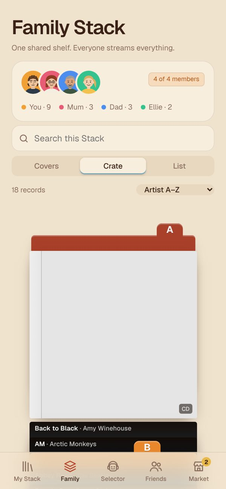
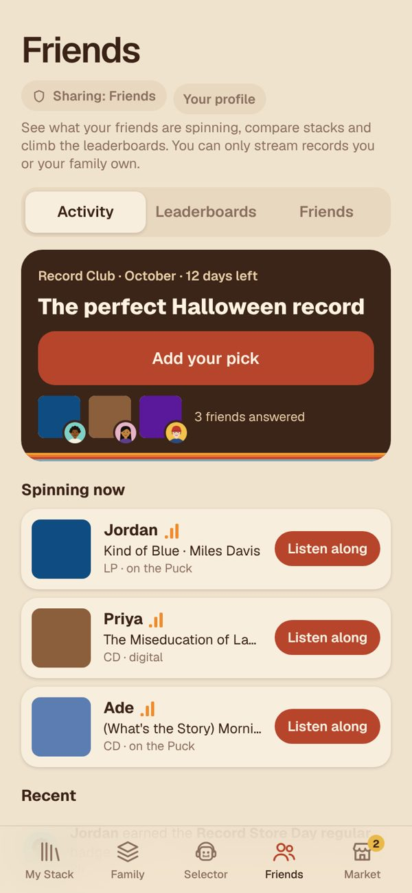
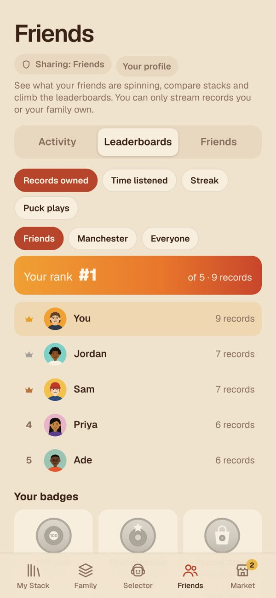
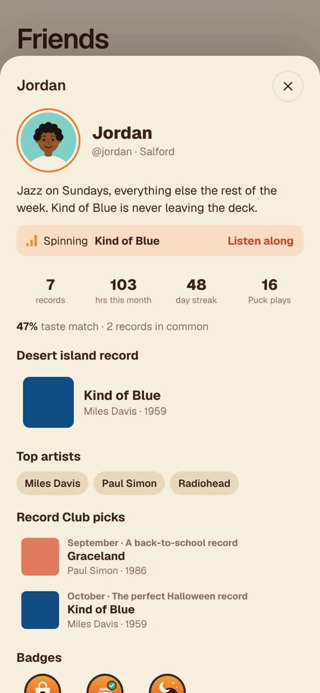
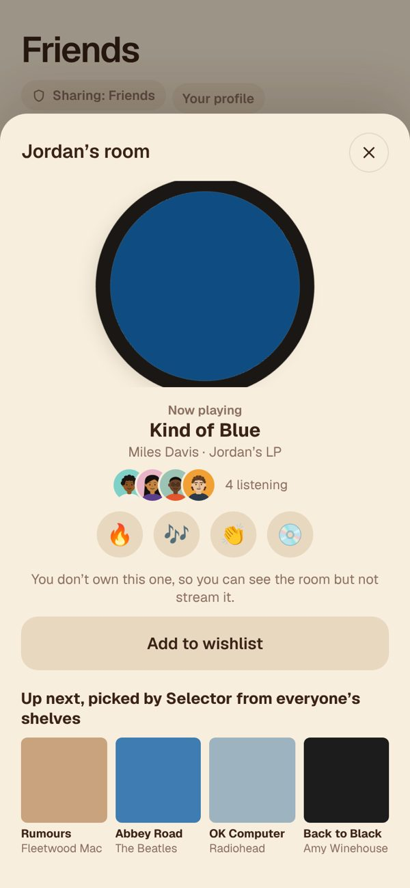
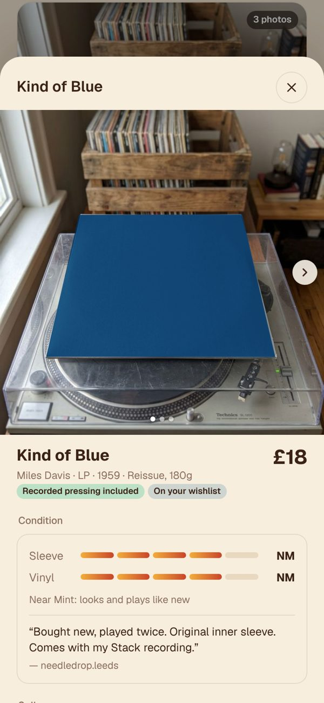

# Stack

**Own it. Play it everywhere.**

Stack is a prototype app for people who collect vinyl and CDs. You add the records you own, and Stack turns that shelf into the way you listen: browse your covers, drop the needle on a record, share your collection with family and friends, and take it with you on your phone.

Designed and built by **Harrison Greener**.

**Live demo:** https://harrisongreener.github.io/stack/

On an iPhone, open it in Safari, then Share → Add to Home Screen to run it full-screen like a real app. It also works in a desktop browser, where a panel of demo shortcuts sits beside a phone-sized screen.

---

## A look inside

<table>
<tr><td align="center" valign="top" width="25%"> The opening film: DJ Selector runs along a spinning record</td><td align="center" valign="top" width="25%"> Explaining the Puck, the turntable accessory</td><td align="center" valign="top" width="25%"> The loading screen, a record label that spins in</td><td align="center" valign="top" width="25%"> My Stack: your records, with search, Liked songs and a notification bell</td></tr>
<tr><td align="center" valign="top" width="25%"> The turntable player</td><td align="center" valign="top" width="25%"> Your copy: choose your vinyl colour</td><td align="center" valign="top" width="25%"> Two decks and a crossfader</td><td align="center" valign="top" width="25%"> DJ Selector, your robot DJ</td></tr>
<tr><td align="center" valign="top" width="25%"> Family Stack, here in crate view</td><td align="center" valign="top" width="25%"> Friends: Record Club and who's spinning now</td><td align="center" valign="top" width="25%"> Leaderboards and badges</td><td align="center" valign="top" width="25%"> A friend's profile</td></tr>
<tr><td align="center" valign="top" width="25%"> Listening along in a friend's room</td><td align="center" valign="top" width="25%"> Your stats, with you vs friends</td><td align="center" valign="top" width="25%"> Marketplace: second-hand records from other collectors</td><td align="center" valign="top" width="25%"> A listing: photos, grading and the seller's note</td></tr>
</table>

Screenshots are from the live demo. Album artwork shown in screenshots belongs to the artists and labels and is used for demonstration only; on the live site it loads from the Apple Music and Deezer APIs.

---

## Why I made it

Streaming made music easy to reach but hard to own. Subscriptions can drop an album overnight, and a playlist is rented space, not a collection. Meanwhile people keep buying vinyl and CDs, because they want something they actually own and can hold.

The problem is that physical records and phones don't talk to each other. If you own *Rumours* on vinyl, you can't pull it up on your phone on the bus. You pay again for a streaming service to hear music you already own.

Stack is my answer to one question: **what if owning the record was the thing that unlocked it everywhere?** Every feature is there to make owning music feel better than renting it.

Stack is a design prototype. It explores the idea, the interface and the experience, and it is honest about what is simulated (see below).

---

## What the app does

### Your collection
- **My Stack:** your records shown as covers, a crate you flick through, or a list. Search by song, album or artist.
- **Add records** by search, by scanning a barcode, or by importing from Discogs.
- **Your copy:** record the pressing, condition, where you bought it, what you paid, whether it is signed, and the **vinyl colour** (black, solid, translucent, clear, marble, splatter, galaxy, half and half, tri-colour or picture disc). The record you see spinning matches the one on your shelf.
- **Mixtapes and Liked songs** sit alongside, and a notification bell collects mixtapes sent to you, loans and "dust it off" reminders.

### Listening
- A **turntable-style player** with a spinning record, tonearm, up next and sides.
- **Two decks and a crossfader:** load a second record and slide between them with your finger, or let it fade across for you.
- **My pressing:** a mode that adds the surface noise, pops and slight wobble of a real record.
- **Lock screen:** a padlock in the player blocks accidental touches, and the screen stays awake while a record plays.
- Playback uses 30-second previews, standing in for the full tracks a real release would play.

### Family
- **Family Stack:** one shared shelf for the people you live with, showing whose copy each record is. Browse it as covers, a crate or a list, and search it.
- **Lending:** lend a record to a friend. While it is lent it is theirs to play and not yours, just like the real thing, until they give it back.

### Friends
- **Activity:** see what friends are spinning right now, on vinyl, CD or digital, plus a feed of new records, badges and streaks.
- **Listening rooms:** join a friend's room to listen along, send reactions and see what DJ Selector is lining up from everyone's shelves. You can only stream records you or your family own.
- **Record Club:** a theme every month, like "the perfect Halloween record" in October. Search any album to answer, whether you own it or not, and your picks build up on your profile.
- **Leaderboards:** records owned, time listened, streaks and Puck plays, against friends, your city or everyone.
- **Badges:** collector milestones such as the 100 club, first pressing and crate digger, earned from your real stats.
- **Profiles:** a bio, location, stats, top artists, desert island record, Record Club picks, badges and the records you both own. Edit your own from Your profile.
- **Friends' Stacks:** browse a friend's records as covers, a crate or a list, search them, see your taste match, and add to your wishlist.
- **Sharing controls:** choose friends, everyone or only you, and switch your collection, listening, stats and "spinning now" on or off.

### Discovery and insight
- **DJ Selector:** a cel-shaded robot DJ who digs through your crate. Ask it for a mood or an idea and it builds a queue from records you own.
- **Stats and Wrapped:** what you play most, how you compare with your friends, and a year-end recap.
- **Dust it off:** a nudge to play the record you have not touched in months.

### Marketplace
Buy and sell second-hand vinyl and CDs with other collectors.
- **Browse and search** listings with real photos, the pressing, sleeve and vinyl grading, vinyl colour, price history and the seller's rating. Filter by format, condition, price and distance.
- **Buy safely.** You pay Stack, and Stack holds the money until you confirm the record arrived. Only then is the seller paid, and the digital copy, plus the seller's recorded pressing if it was included, moves to you.
- **Make an offer or message the seller** from any listing.
- **Sell** any record in your Stack, starting with photos. Once the buyer confirms it arrived, you lose the digital copy and your recorded pressing, exactly like handing over the real record. Lent records can't be sold until they come back.
- **Wishlist** alerts you when someone lists a record you want, and **Nearby** shows independent record shops and their events.

### Stack Supply
Stack's own shop for clothing, record gear and the Puck, inside the Market tab. Checkout is a demo, and no payment is taken.

### The Puck
A small device that sits between your turntable and speakers. It records your own copy of each record in hi-res, crackle and all, and logs what you play, so a physical spin counts toward your stats just like a digital one. It comes in black, white or orange, from £30, or in packs of two and three. In this prototype it is simulated.

### The opening film
The first thing you see is a short real-time 3D film, rendered live in the browser with Three.js. DJ Selector runs along a spinning record, explains what Stack is and how the Puck works, and gets flung off, and the camera dives into the record label and hands over to the loading screen. You can pause it and skip back or forward between sections.

---

## What is real and what is simulated

| Real | Simulated |
|---|---|
| The interface, navigation and interactions | Accounts, family plans, friends, profiles and leaderboard figures are demo data |
| Audio: 30-second previews looked up live from the Apple Music and Deezer APIs, with crossfade through the Web Audio API | Full-length playback and ownership checks |
| Official album artwork loaded from those same services | The Puck, barcode scanning and Discogs import |
| The 3D intro film, built in code | Listening rooms, reactions and live activity |
| Marketplace flow: listing, fees, held payment and ownership moving on arrival | Other sellers, buyers, payments and deliveries |
| Shop products, colours, sizes and basket | Checkout: no payment is taken |

---

## Copyright and credits

- **Design:** the Stack app, brand, logo, DJ Selector character, the Puck and the merchandise designs are by Harrison Greener.
- **Album artwork and audio** belong to their artists and labels. The app itself stores no artwork or audio: artwork and 30-second previews are loaded at the moment you view or play them, from the public Apple Music (iTunes Search) and Deezer APIs, for demonstration only.
- **Marketplace photos** of records are AI-generated scenes. The album cover in each one is placed on top in the browser at runtime from the APIs above, so the repository holds no cover art.
- **Product and lookbook images** are AI-generated mockups of my own designs, made for this project.
- **Names:** artist names, album titles and Discogs, Apple Music and Deezer belong to their owners. Stack is not affiliated with, or endorsed by, any of them. Shops, sellers and users in the demo are fictional.
- **Open source:** [Three.js](https://threejs.org) (MIT licence) and the Geist, Caveat and Shrikhand fonts from Google Fonts (SIL Open Font Licence).
- This is a non-commercial university project, not a product on sale.

---

## Open questions

Rather than pretend a prototype answers everything, these are the questions behind the design:

- **Rights.** A real version needs licences from labels. What you may legally copy from a record you own for personal use differs between countries, so a real product would have to be built with rights holders, not around them.
- **Proving ownership.** A barcode scan, a Puck or a shop receipt can each suggest you own a record, but none is perfect. The Puck is the concept for stronger proof.
- **Second-hand sales.** Moving the digital copy with the physical one only works if the record really changes hands, which is why payment is held until the buyer confirms it arrived.

---

## Try it

Open the live demo. On a phone, tap **Account → Demo shortcuts** to jump to any feature: the intro film, the loading screen, the player, two decks, lending, stats, DJ Selector, the Marketplace, selling a record and more. On a computer the shortcuts are in the panel beside the phone.

Add `?nofilm` to the address to skip the intro film, or `?demo` to open the shortcuts straight away.

## Built with

A single HTML file, with vanilla JavaScript and CSS and no framework. Three.js draws the intro film, the Web Audio API handles the crossfade and the record-noise effects, and artwork and previews come from the Apple Music (iTunes Search) and Deezer public APIs. It is designed first for iPhone and runs as a Home Screen web app.
