# Stack

**Own it. Play it everywhere.**

Stack is a prototype app for people who collect vinyl and CDs. You add the records you own, and Stack turns that shelf into the way you listen: browse your covers, drop the needle on a record, share your collection with family and friends, and take it with you on your phone.

**Live demo:** https://harrisongreener.github.io/stack/

On an iPhone, open it in Safari, then Share → Add to Home Screen to run it full-screen like a real app. It also works in a desktop browser, where a panel of demo shortcuts sits beside a phone-sized screen.

---

## A look inside

<table>
<tr><td align="center" valign="top" width="25%">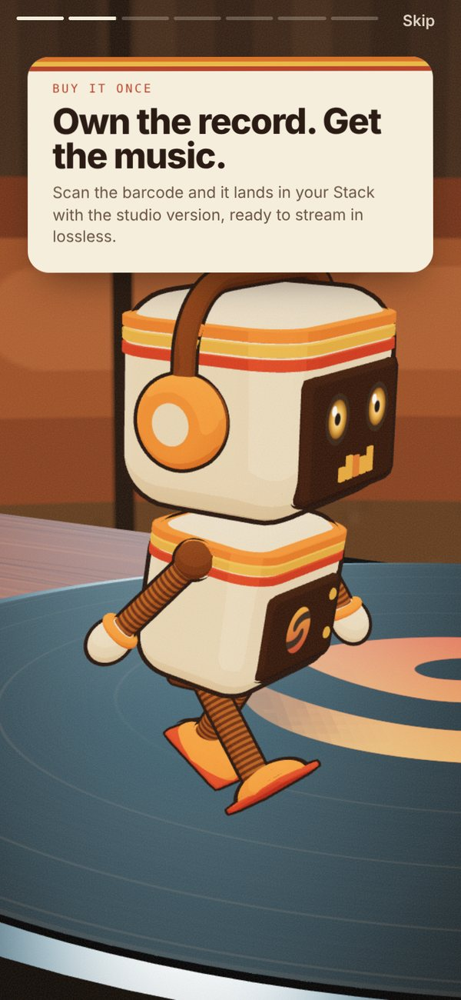 The opening film: the Selector runs along a spinning record</td><td align="center" valign="top" width="25%">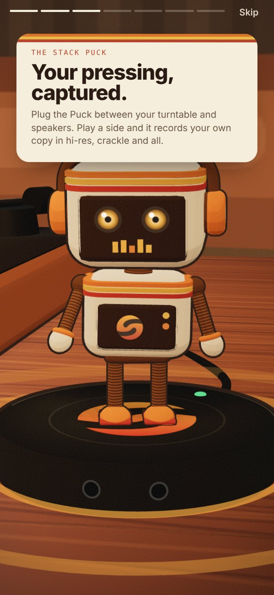 Explaining the Puck, the turntable accessory</td><td align="center" valign="top" width="25%">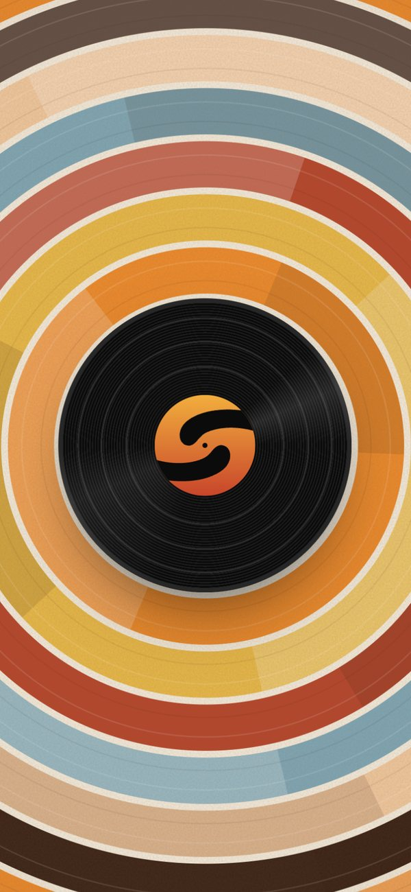 The loading screen, a record label that spins in</td><td align="center" valign="top" width="25%">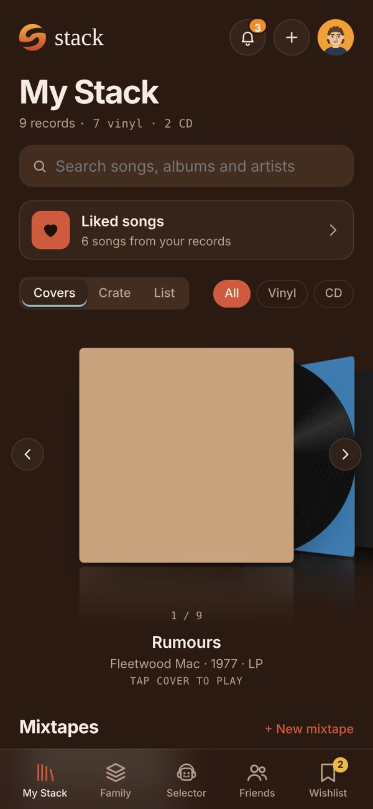 My Stack: your records, with search, Liked songs and a notification bell</td></tr>
<tr><td align="center" valign="top" width="25%">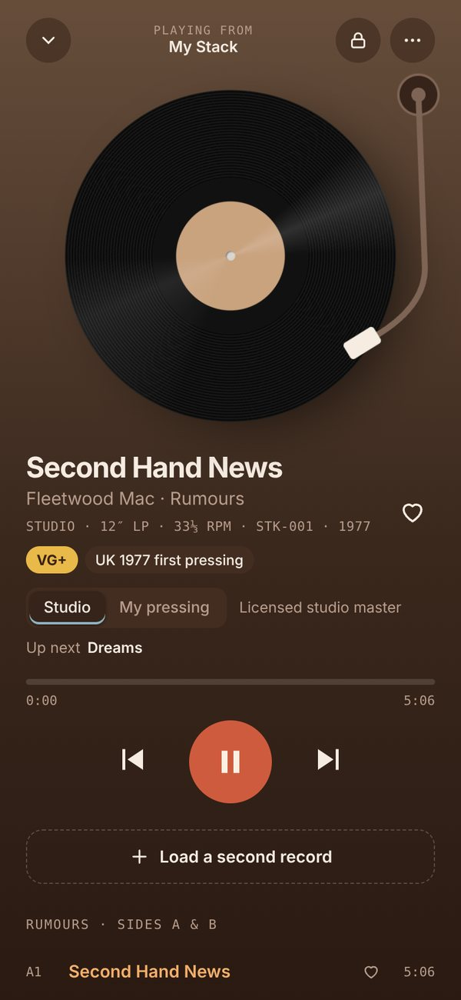 The turntable player</td><td align="center" valign="top" width="25%">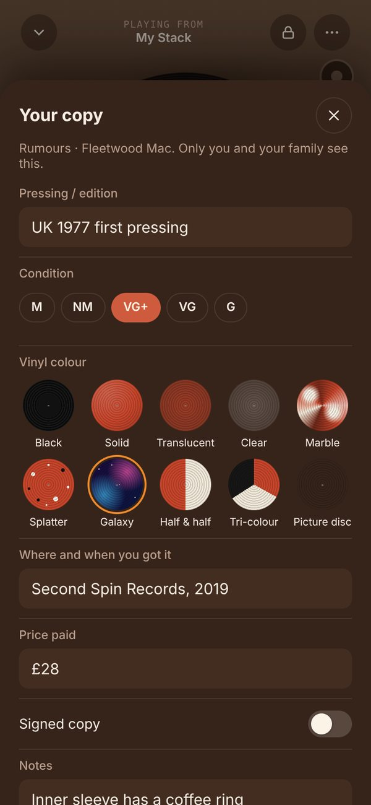 Your copy: choose your vinyl colour</td><td align="center" valign="top" width="25%">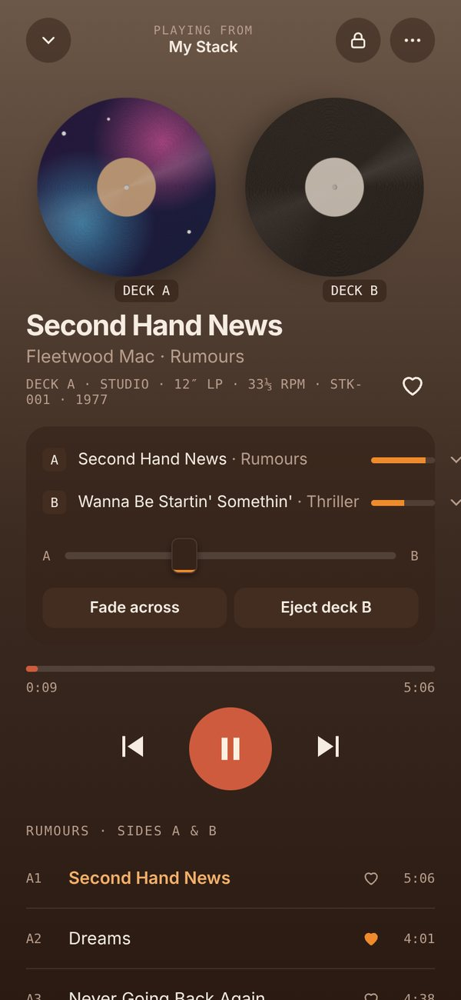 Two decks and a crossfader</td><td align="center" valign="top" width="25%">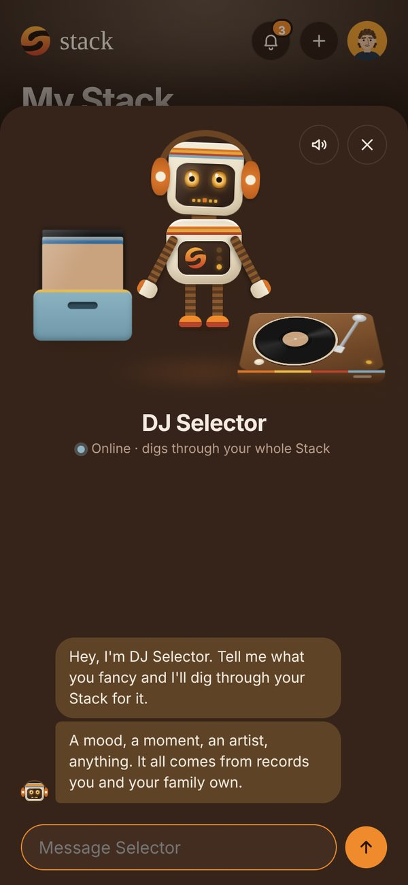 The Selector, your robot DJ</td></tr>
<tr><td align="center" valign="top" width="25%">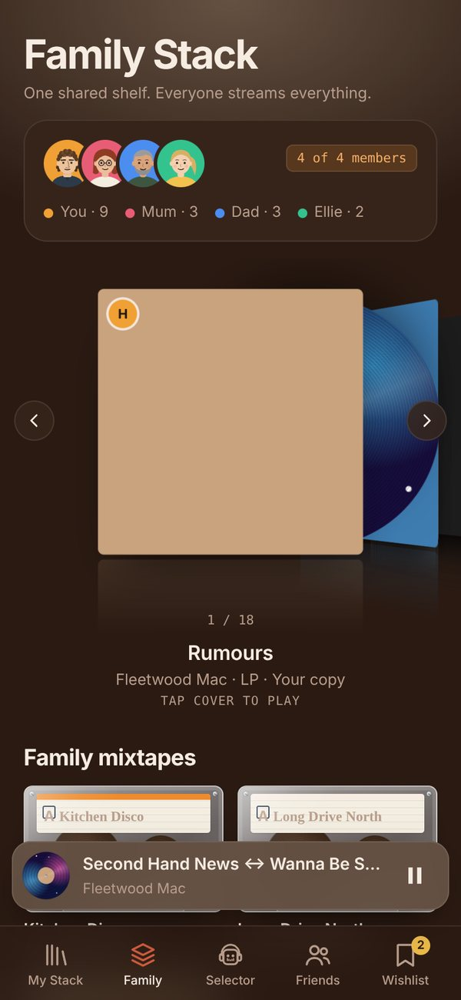 Family Stack: one shared shelf</td><td align="center" valign="top" width="25%">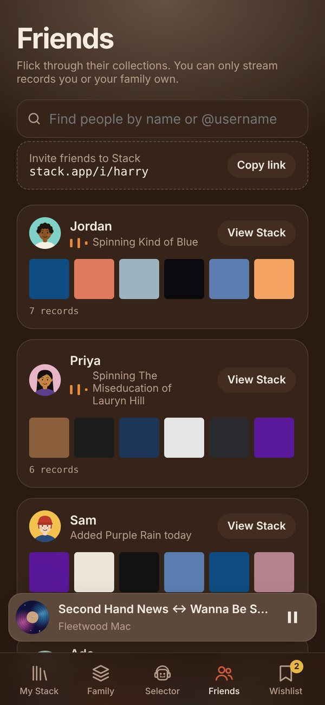 Friends: browse their stacks, you can only stream what you own</td><td align="center" valign="top" width="25%">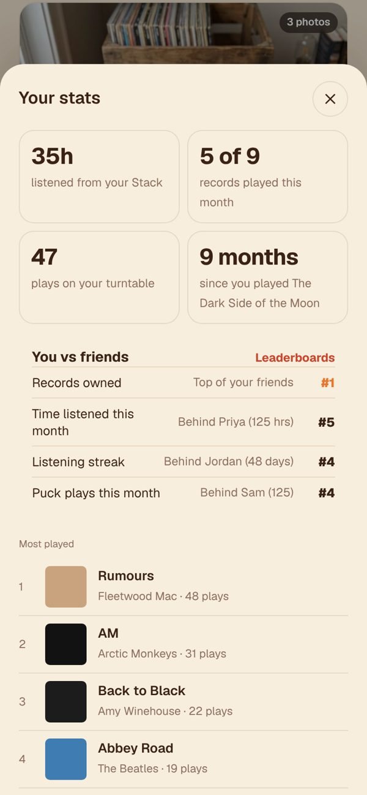 Your stats</td><td align="center" valign="top" width="25%">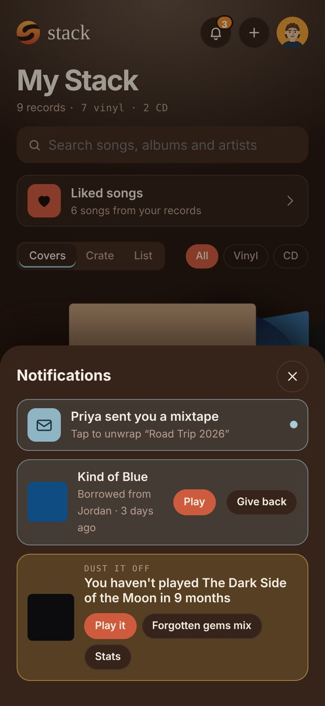 The notification bell keeps My Stack about the music</td></tr>
<tr><td align="center" valign="top" width="25%">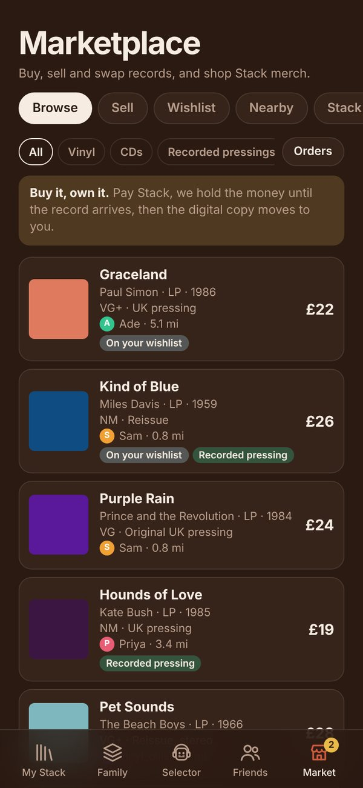 Marketplace: second-hand records from other collectors</td><td align="center" valign="top" width="25%">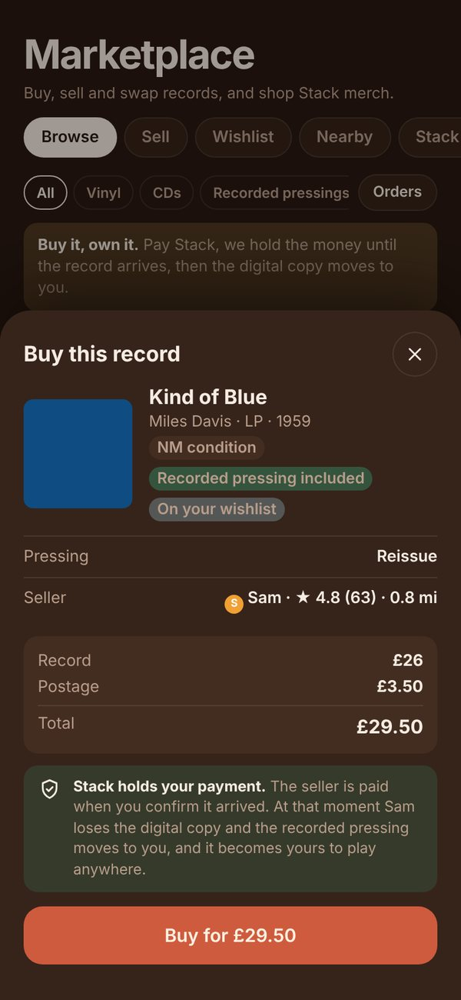 Buying: Stack holds the money until it arrives</td><td align="center" valign="top" width="25%">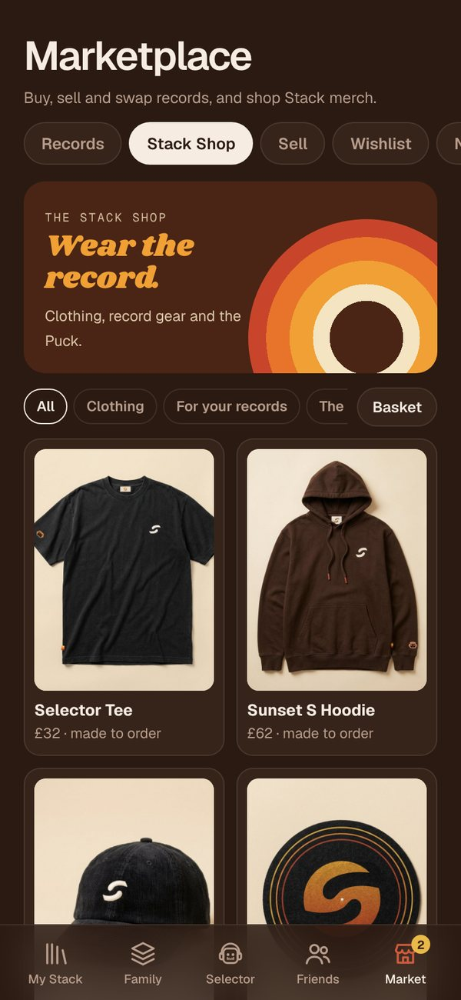 Stack Supply: clothing, record gear and the Puck</td><td align="center" valign="top" width="25%">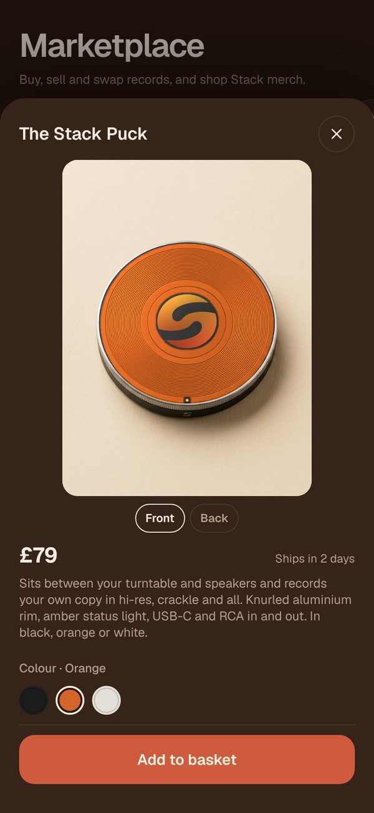 The Stack Puck in black, orange or white</td></tr>
</table>

Screenshots are from the live demo. Album covers show as placeholder art in these screenshots; on the live site, official artwork loads from the Apple Music and Deezer APIs.

---

## Why I made it

Streaming made music easy to reach but hard to own. Subscriptions can drop an album overnight, and a playlist is rented space, not a collection. Meanwhile people keep buying vinyl and CDs, because they want something they actually own and can hold.

The problem is that physical records and phones don't talk to each other. If you own *Rumours* on vinyl, you can't pull it up on your phone on the bus. You pay again for a streaming service to hear music you already own.

Stack is my answer to one question: **what if owning the record was the thing that unlocked it everywhere?** The app is built around that idea, and every feature is there to make owning music feel better than renting it.

Stack is a design prototype. It explores the idea, the interface and the experience, and it is honest about what is simulated (see below).

---

## What the app does

### Your collection
- **My Stack:** your records shown as covers, a crate of spines, or a list. Search by song, album or artist.
- **Add records** by search, by scanning a barcode, or by importing from Discogs.
- **Your copy:** record the pressing, condition, where you bought it, what you paid, whether it is signed, and the **vinyl colour** (black, solid, translucent, clear, marble, splatter, galaxy, half and half, tri-colour or picture disc). The record you see spinning matches the one on your shelf.
- **Mixtapes and Liked songs** sit alongside, and a notification bell collects mixtapes sent to you, loans and "dust it off" reminders so My Stack stays about the music.

### Listening
- A **turntable-style player** with a spinning record, tonearm, up next and sides.
- **Two decks and a crossfader** so you can mix one record into another.
- **My pressing:** a mode that adds the surface noise, pops and slight wobble of a real record.
- **Lock screen:** a padlock in the player blocks accidental touches, and the screen stays awake while a record plays.
- Playback uses 30-second previews, standing in for the full tracks a real release would play.

### Sharing
- **Family stack:** share a plan with the people you live with and see who owns what.
- **Friends:** browse a friend's Stack, see what they are spinning, add to your wishlist.
- **Lending:** lend a record to a friend. While it is lent it is theirs to play and not yours, just like the real thing, until they give it back.

### Discovery and insight
- **The Selector:** a cel-shaded robot DJ who digs through your crate. Ask it for a mood or an idea and it builds a queue from records you own.
- **Stats and Wrapped:** what you play most, and a year-end style recap.
- **Dust it off:** a nudge to play the record you have not touched in months, with a "forgotten gems" mix.

### Marketplace
- **Browse** second-hand records listed by other collectors, with the pressing, condition, vinyl colour and seller rating. Filter by vinyl, CD, or copies that come with a recorded pressing.
- **Buy safely.** You pay Stack, and Stack holds the money until you confirm the record arrived. Only then is the seller paid, and the digital copy, plus the seller's recorded pressing if it was included, moves to you.
- **Sell** any record in your Stack. You set the price and see the fee and what you take home. Once the buyer confirms it arrived, you lose the digital copy and your recorded pressing, exactly like handing over the real record. Lent records can't be sold until they come back.
- **Wishlist:** records you want, with a "for sale now" alert when someone lists one.
- **Nearby:** independent record shops near you, their events and Record Store Day.

### Stack Supply
Stack's own merch and record gear, all in the brand's 70s palette and finished with small details like woven S labels, a tiny embroidered Selector on the sleeve and three-stripe tabs.

<table>
<tr><td align="center" valign="top" width="33%">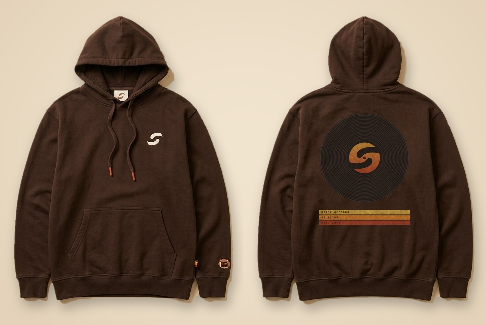 <b>Sunset S Hoodie</b> · £62 Washed record print and labelled stripes on the back</td><td align="center" valign="top" width="33%">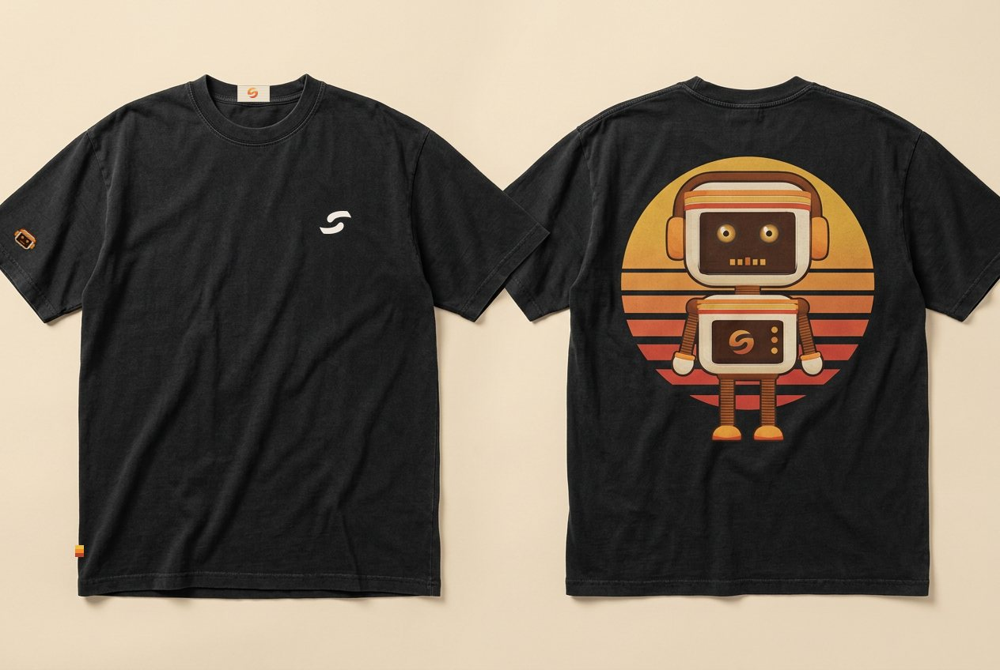 <b>Selector Tee</b> · £32 In washed black, oatmeal, chocolate and rust</td><td align="center" valign="top" width="33%">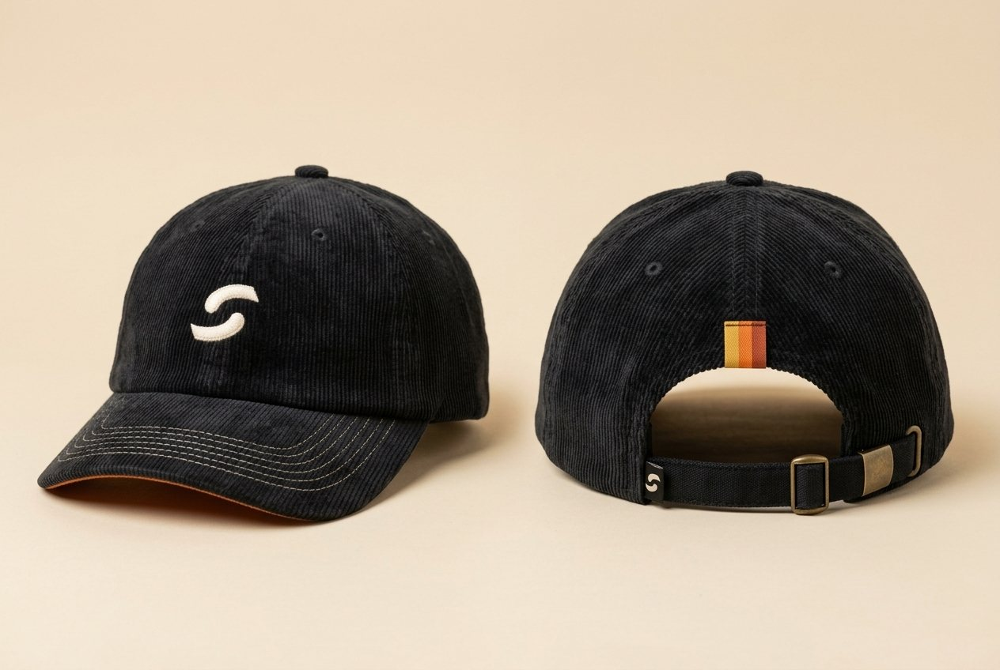 <b>Corduroy S Cap</b> · £28 Embroidered S, orange under-brim, brass buckle</td></tr>
<tr><td align="center" valign="top" width="33%">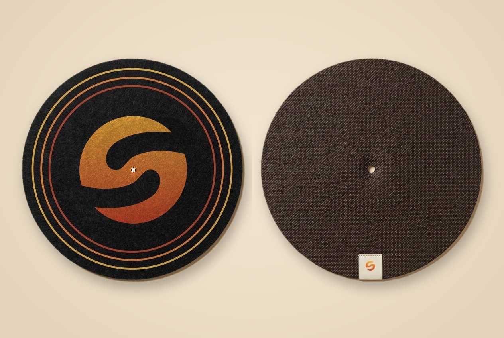 <b>Sunset Slipmat</b> · £18 Felt, with a non-slip underside</td><td align="center" valign="top" width="33%">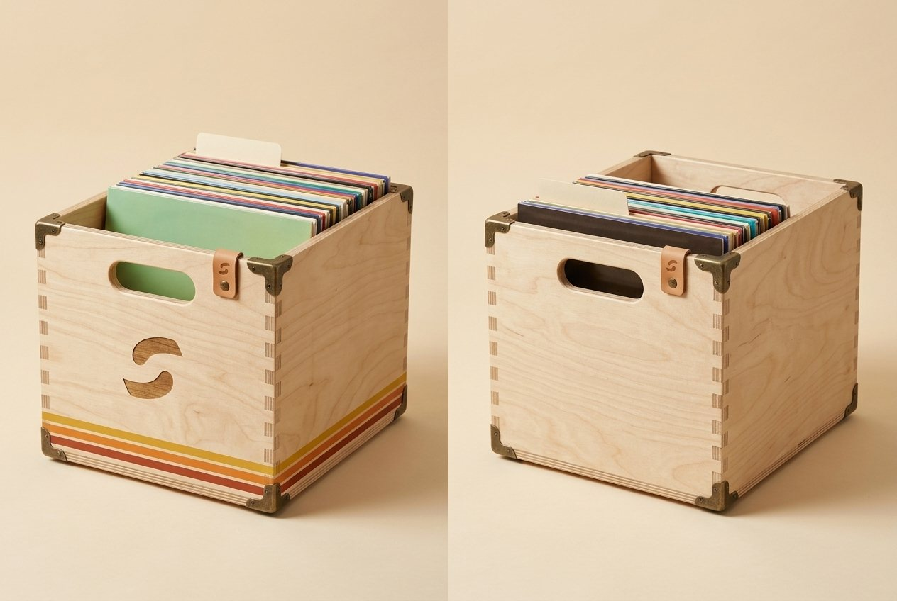 <b>Birch Record Crate</b> · £48 Holds about 60 LPs</td><td align="center" valign="top" width="33%">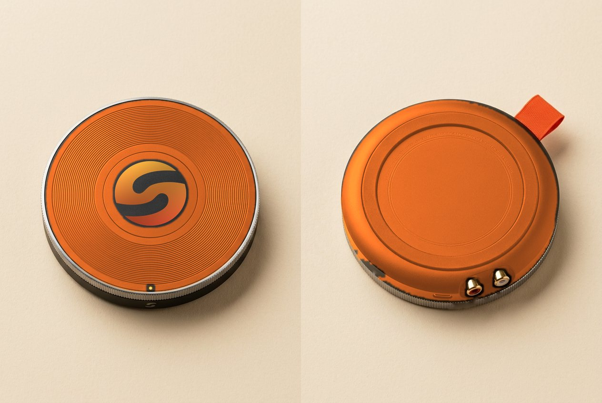 <b>The Stack Puck</b> · from £30 In black, orange or white</td></tr>
</table>

Each product has front and back photos in the app, plus colours and sizes where they apply. Checkout is a demo, and no payment is taken.

### The Puck
A small device that sits between your turntable and speakers. It records your own copy of each record in hi-res, crackle and all, and logs what you play, so a physical spin counts toward your stats just like a digital one. It comes in black, orange or white. In this prototype it is simulated.

### The opening film
The first thing you see is a short real-time 3D film, rendered live in the browser with Three.js. The Selector runs along a spinning record, explains what Stack is and how the Puck works, and gets flung off, and the camera dives into the record label and hands over to the loading screen.

---

## What is real and what is simulated

| Real | Simulated |
|---|---|
| The interface, navigation and interactions | Accounts, family plans and friends are demo data |
| Audio: 30-second previews looked up live from the Apple Music and Deezer APIs, with crossfade through the Web Audio API | Full-length playback and ownership checks |
| Official album artwork loaded from those same services | The Puck, barcode scanning and Discogs import |
| The 3D intro film, built in code | Shop details and Record Store Day events |
| Marketplace flow: listing, fees, held payment and ownership moving on arrival | Other sellers, buyers, payments and deliveries |
| Stack Shop products, colours, sizes, basket and order flow | Checkout: no payment is taken |

No copyrighted audio or artwork is stored in this repository. Previews and artwork come from the public APIs at the moment you play.

---

## Open questions

Rather than pretend a prototype answers everything, these are the questions behind the design:

- **Rights.** A real version needs licences from labels. What you may legally copy from a record you own for personal use differs between countries, so a real product would have to be built with rights holders, not around them.
- **Proving ownership.** A barcode scan, a Puck or a shop receipt can each suggest you own a record, but none is perfect. The Puck is the concept for stronger proof.
- **Who benefits.** Ideally artists and independent shops earn *more* when someone buys a record, not less, which is why shops and Record Store Day are part of the app.

---

## Try it

Open the live demo. On a phone, tap **Account → Demo shortcuts** to jump to any feature: the intro film, the loading screen, the player, two decks, lending, stats, the Selector, the Marketplace, selling a record, Stack Supply and more. On a computer the shortcuts are in the panel beside the phone.

Add `?nofilm` to the address to skip the intro film, or `?demo` to open the shortcuts straight away.

## Built with

A single HTML file, with vanilla JavaScript and CSS and no framework. [Three.js](https://threejs.org) draws the intro film, the Web Audio API handles the crossfade and the record-noise effects, and artwork and previews come from the Apple Music (iTunes Search) and Deezer public APIs. It is designed first for iPhone and runs as a Home Screen web app.

## Credits

Designed and built by Harrison Greener. Album artwork and audio previews belong to their respective artists and labels and are loaded from the services above for demonstration only.
